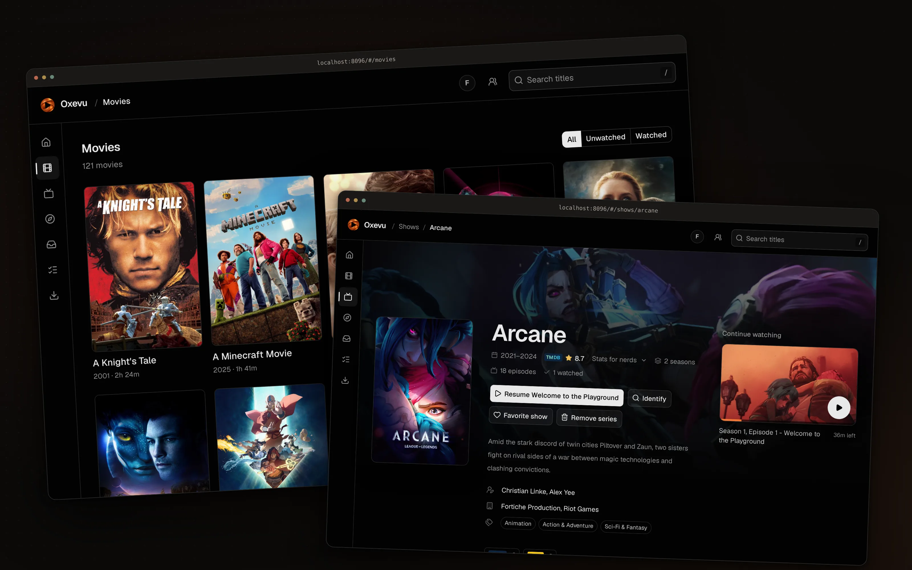
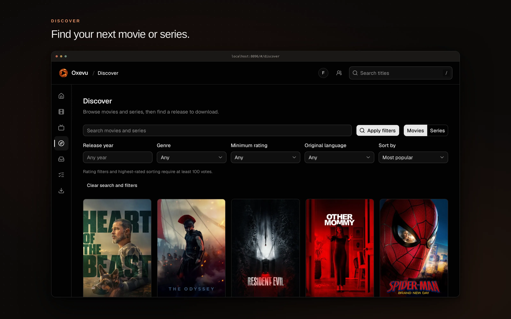
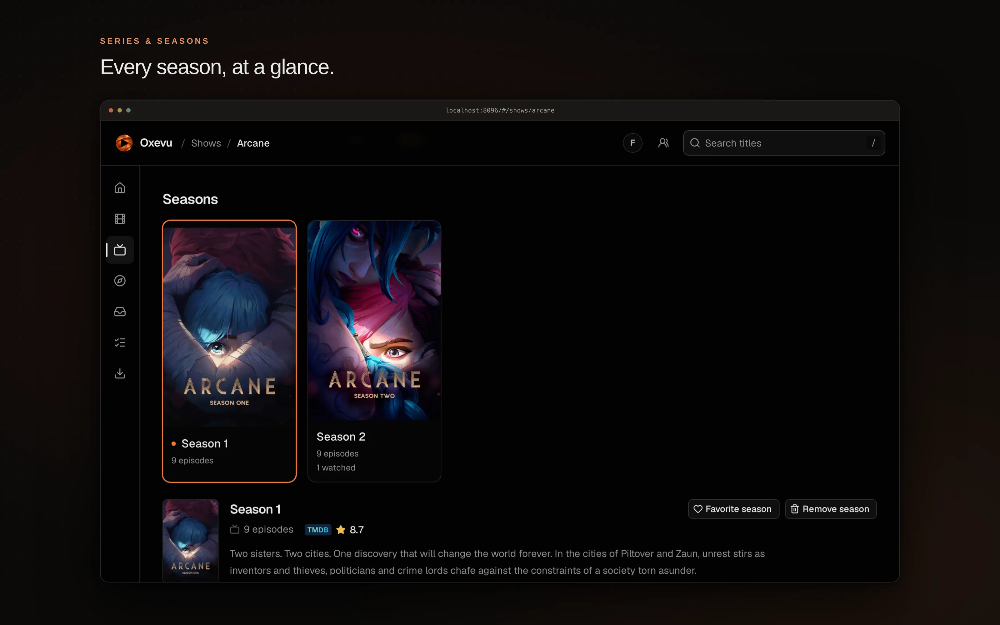
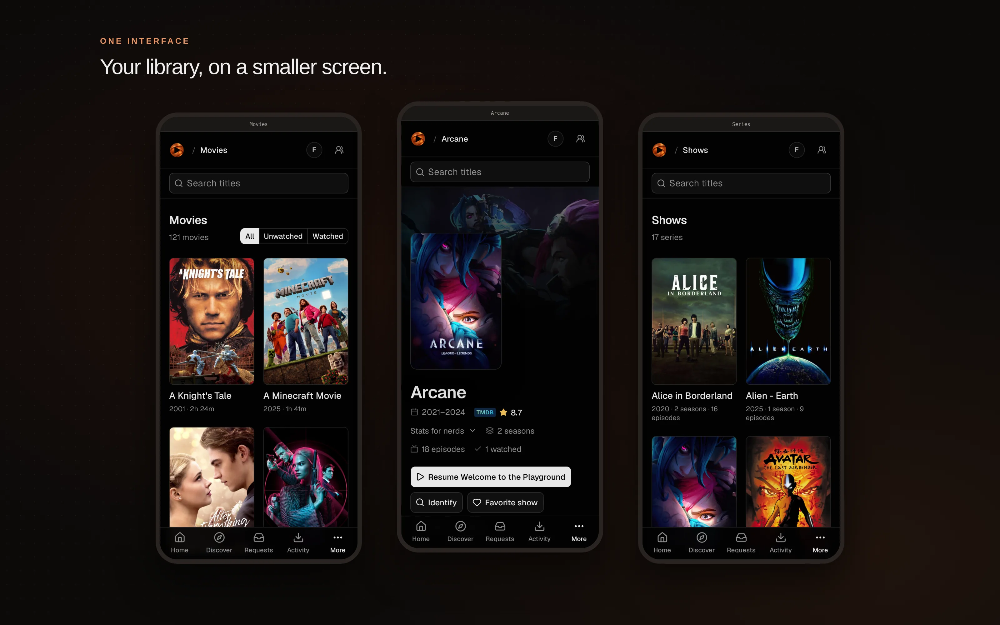

<p align="center">
  
</p>

<p align="center">
  <a href="CHANGELOG.md"></a>
  <a href="flake.nix"></a>
  <a href="docs/mobile.md"></a>
</p>

<h1 align="center">Oxevu</h1>

<p align="center">
  
</p>

<p align="center">A self-hosted home for your movies and series.</p>

Oxevu brings library browsing, playback, discovery and downloads into one Rust server with an embedded Svelte interface. Point it at your existing media folders, connect your metadata providers and indexers, and use the same frontend on the web or in the Capacitor Android app.

It is in early development. The Android build is a preview; physical-device acceptance and iOS packaging are still pending.

- **Watch** movies and series with subtitles, saved progress, favorites, watch parties and FFmpeg/NVIDIA conversion.
- **Find** titles in Discover, filter the catalog and search configured indexers directly. Accounts that need approval can submit requests.
- **Download** a selected release and import completed files into your library using configured destinations. Ordinary library scans keep media read-only.

## Quick start

From a checkout, with Nix installed:

```sh
OXEVU_BIND=127.0.0.1:8096 \
OXEVU_ORIGIN=http://localhost:8096 \
nix run .#
```

Open `http://localhost:8096`. On first run, use the setup token from the data directory to create an administrator, then add and scan your movie and TV folders. The default data directory is `~/.local/share/oxevu`; choose a free port if 8096 is already in use.

See [server setup](docs/development.md#run-the-first-application), [the NixOS service module](nix/module.nix), [metadata providers](docs/integrations.md) and [downloads and imports](docs/acquisition.md) for configuration.

## A closer look

<table>
  <tr>
    <td width="50%"></td>
    <td width="50%"></td>
  </tr>
  <tr>
    <td colspan="2"></td>
  </tr>
</table>

These images were captured from the running production instance. Mobile images show the responsive web interface.

## Project notes

- [Development and contributions](CONTRIBUTING.md)
- [Architecture](docs/architecture.md) and [playback](docs/playback.md)
- [Android build and mobile acceptance](docs/mobile.md)
- [Roadmap](GOAL.md) and [changelog](CHANGELOG.md)

## License

A project license has not been specified yet. Movie and series artwork shown in the screenshots belongs to its respective rights holders.
